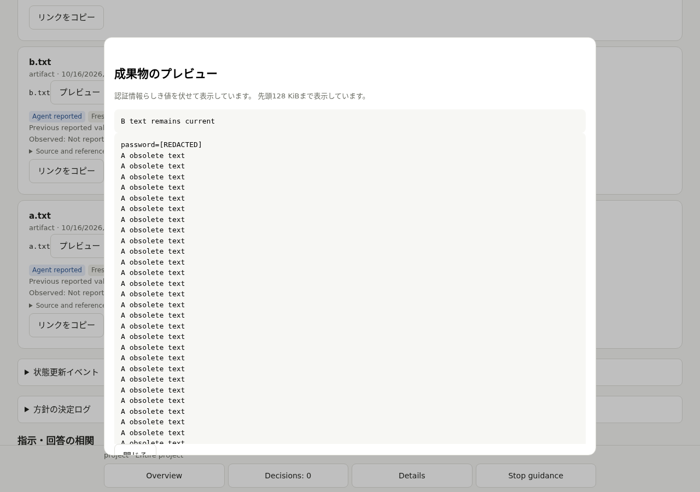
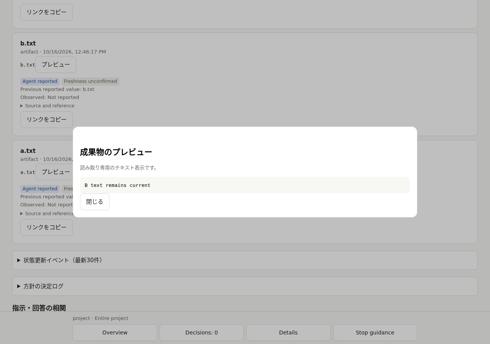
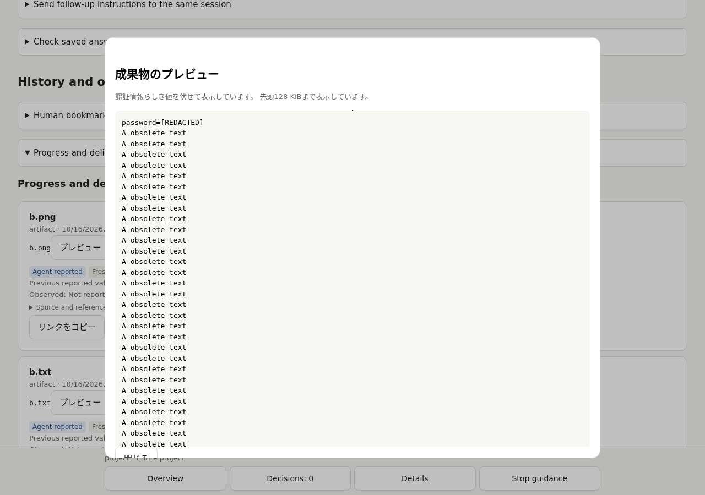
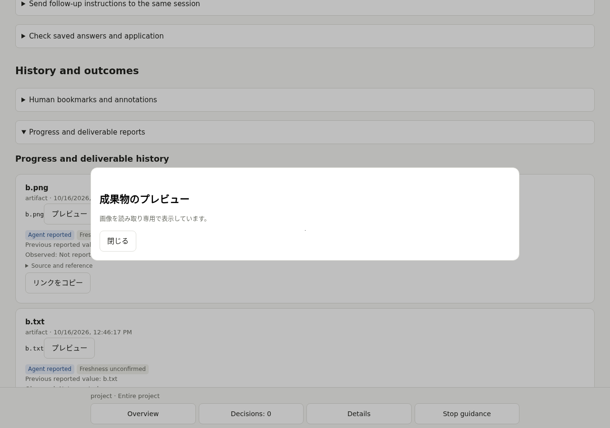
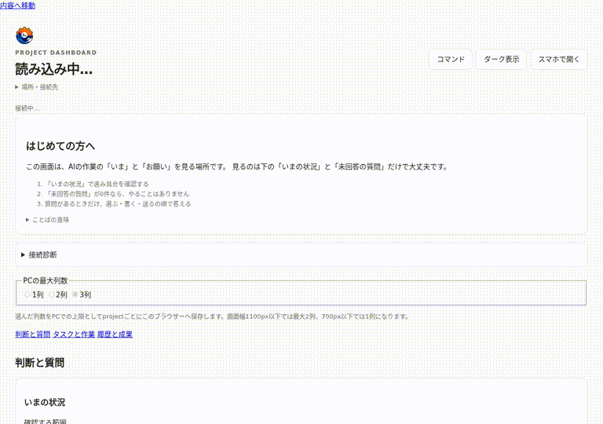

# Artifact preview の回帰証拠

修正: `1cf9db366cb5cb097d8e6ec3ba2e76282d3d96ff`。
検証した HEAD: `1d05cd4`（最新 upstream `cc4406e` を統合）。
対象: [jimoto-no-llm/rustdsh](https://github.com/jimoto-no-llm/rustdsh)。

[#237](https://github.com/jimoto-no-llm/rustdsh/pull/237) の eightman999、Eureka-COM、cyrne1-7208、kuraneko1 の報告・追確認を参照した修正であり、新規発見の主張ではありません。
[#648](https://github.com/jimoto-no-llm/rustdsh/pull/648) の境界保護を維持しています。

## 実ブラウザーでの比較

実 app/report ボタン → 認証済み HTTP → 実 Blob/DOM の経路を使用しました。
Blob.text の Promise だけを制御し、A の decode 待機 → native close イベント完了 → B 表示 → A の decode 解放を確実に並べています。
任意 sleep、確率的 race loop、関数の書き直したコピー、mock 画像は使っていません。

比較前は upstream の無改変 app.mjs、比較後は修正版です。比較は同じ隔離された修正版 backend 上での frontend 比較です。
未変更 upstream server/app 全体での同じ不具合再現も、別 worktree で事前に確認済みです。

| ケース | 変更前 | 変更後 |
|---|---|---|
| B が text | A の pre が混入、status 上書き | B の本文・status を維持 |
| B が image | A の pre が混入、status 上書き | B の画像・status を維持 |
| close のみ | 閉じた dialog の本文・status を書き換え | 内容・status・open=false を維持 |
| decode 中に revision 更新 | 鮮度表示を取りこぼす | commit 時点の鮮度を表示 |

[変更前の機械可読観測](before.json) / [変更後の機械可読観測](after.json)。
両方とも page error は0。修正版では B 画像の object URL を一度だけ revoke する assertion も成功。
旧 callback の ReferenceError は現行 upstream にはなく、実ボタンからの到達を確認しています。

### text の変更前・変更後

### image の変更前・変更後

### 実操作の動画から作成した GIF

## 検証環境

Debian 13 の隔離 Docker、Node.js 22.23.3、実 Chromium 155.0.8059.79、1280×900。
非 root uid 1000、委譲 cgroup v2、実 pidfd、実 bubblewrap/seccomp を使用しています。
Node は CI と同様に固定 Docker worker パスと異なる `/opt/rdsh-node22/bin/node` に配置しました。
NODE_OPTIONS/NODE_PATH のない環境で、製品 guard・assertion・期限は変更していません。

Playwright のダウンロード用ドメインは環境で403になるため、Debian の実 Chromium と ffmpeg を使用しています。
RDSH_CHROME_PATH を尊重しない既存スクリプト用には、テスト専用の実行ファイルリンクを同じ system Chromium に向けています。
ダウンロード版 Playwright Chromium での検証とは主張しません。

すべて loopback、隔離 HOME/project/state、一時ファイル、合成資格情報です。provider/model 呼び出し、Tailscale 共有、実ユーザーファイルは使っていません。
Windows/macOS の実機検証は対象外です。非 Linux の既存 post-open realpath/identity 再検査を atomic な保証とは扱いません。

## 処理側の再現と性能

旧版では FIFO の2ケース（最初から存在・検査後 open 直前に置換）を親プロセスの10秒 watchdog が SIGKILL しました。
修正版では両方415で拒否し、read せず handle cleanup を確認しています。
UTF-8 の2/3/4 byte code point、正確な上限・上限超過、秘密が表示境界をまたぐケース、最大1 MiBの通常文・不正に近い URL を回帰検証しました。

実 createArtifactPreview に同じ合成 fixture を渡した計測です。Node 24.19.0 / Linux 6.18.44 / x64 / Xeon Platinum 8573C、各1回・専用 warmupなし。
修正後の測定中には他の検証も動作していました。portable な benchmark target ではありません。

| 入力 | 旧 ms | 新 ms |
|---|---:|---:|
| 8 KiB | 68.53 | 3.28 |
| 16 KiB | 241.49 | 19.19 |
| 32 KiB | 1272.51 | 11.42 |

全測定で status=200、通常文の bytes は不変。合成300ケースでも新旧の出力 bytes/flags が一致しました。
旧版で最大1 MiBの危険な同期処理を実行したとは主張しません。
修正版の最大入力は子プロセスを外部 watchdog で制御し、厳しいマシン依存の timing assertion は設けていません。

この証拠ブランチは画像・観測の保存専用です。修正 PR のコード差分には生成物を含めていません。

## 最終検証結果

すべて修正 HEAD のソースに対して自分で実行した結果です。別の投稿者の結果や pending CI は加算していません。

| コマンド | 結果 |
|---|---|
| `node --test dashboard/test/artifact-preview.test.mjs dashboard/test/artifact-preview-bounds.test.mjs` | 14成功、失敗/skip0 |
| `RDSH_CHECK_BASE=upstream/main sh scripts/check.sh` | exit0。内部の `npm test --prefix dashboard`: 全816件・790成功・失敗0・既定skip26。upstream conflict比較も成功 |
| `RDSH_E2E_BIN=./target/release/rdsh npm test --prefix tests/e2e` | exit0、QA matrix・全 browser flow・最後のartifact preview 4ケースまで完走 |
| `cargo fmt --check` | 成功 |
| `cargo clippy --all-targets -- -D warnings` | 成功 |
| `cargo clippy --release --all-targets -- -D warnings` | 成功 |
| `cargo test --release` | 840成功・失敗/ignore0 |
| `cargo test --release --example benchmark_extended` | 3成功 |
| `cargo test --release --example benchmark_models` | 12成功 |
| `node --test tests/model_benchmark/fence.test.mjs` | 2成功 |
| `sh tests/regress.sh` | 102項目成功 |
| `git diff upstream/main...HEAD --check` | 成功 |

全体テストは Node の同時実行数を抑えられる CPU affinity 2 の委譲環境で実行し、assertion・期限は不変です。
OS固有などの既定skip26を成功件数に含めていません。実機検証は依頼範囲から除外されています。
初回の環境不備・並列負荷の失敗ログもローカルに残し、上記の成功として扱っていません。

`scripts/check.sh` は browser E2E を自動実行しないため todo と表示しますが、同じ HEAD で上記の別コマンドを実行して成功しました。
全リポジトリの markdownlint と GitHub CI はこのローカル検証の成功として扱っていません。

`check-conflicts.sh --base upstream/main --open-prs --require-fetch` の Git 比較は成功しました。
CLI の open PR 取得は環境の api.github.com 制限で403になるため、接続 GitHub API から open PR #665/#666/#667 の全変更ファイルを取得して照合し、対象7ファイルとの重複なし・同topic PRなしを確認しています。
CLI のAPI取得が成功したとは主張しません。
